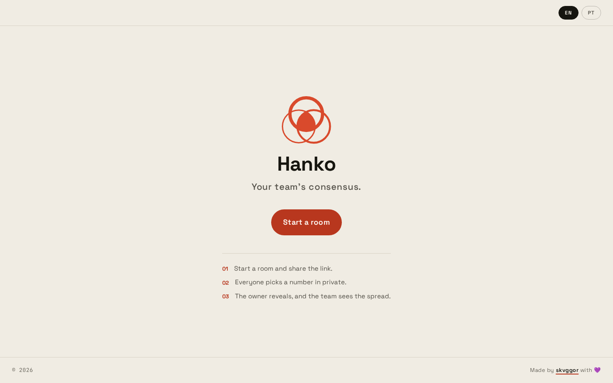

# Hanko

Room-based planning poker. A team opens a room, shares the link, everyone picks a card
privately, and the room owner reveals.

There are no accounts and no sign-up. **The room id is the only secret guarding a room.**
That single decision shapes almost everything else about how this is built.



**Using Hanko?** The [user manual](docs/MANUAL.md) walks through every step with
screenshots, from opening a room to reading the consensus.

## Contents

- [User manual](docs/MANUAL.md)
- [How it works](#how-it-works)
- [Running it](#running-it)
- [Architecture](#architecture)
- [Decisions worth knowing](#decisions-worth-knowing)
- [Layout](#layout)
- [Commands](#commands)
- [Testing](#testing)
- [Contributing](#contributing)
- [Security model](#security-model)
- [License](#license)

## How it works

1. Someone presses **Start a room**. `POST /api/room/create` draws an id and returns it.
   No Durable Object is instantiated yet.
2. They share `/room/<id>`. Deep links work because Cloudflare Static Assets is configured
   with `not_found_handling: "single-page-application"`, so the same `index.html` is served
   for every path and the client router reads it.
3. Everyone joins with a name. There is no account, so a join produces a random **token**
   stored in `sessionStorage`, scoped per tab.
4. Each person picks a card. Votes are **never sent to the other clients** before the
   reveal; the server holds them and broadcasts only the aggregate progress.
5. The room owner reveals. Everyone sees the distribution, the average and a consensus
   verdict at the same moment.

Decks are Fibonacci (with `?` for "needs discussion" and `coffee`), T-shirt sizes and
Linear 1–10.

## Running it

Requires Node and a Cloudflare account for deployment. Local development runs the Worker
in `workerd` through the Vite plugin, so nothing is deployed to develop.

```bash
npm install
npm run dev
```

`npm install` must not be run with a script-blocking package manager: `package.json`
carries an `allowScripts` allowlist for `esbuild`, `workerd` and `lefthook`, and their
postinstall binaries are required.

## Architecture

Five layers, each a path alias, with the dependency direction a one way street:

```
domain  <-  application  <-  presentation
   ^
   |
 infra
```

| Alias           | Folder             | May import                        |
| --------------- | ------------------ | --------------------------------- |
| `@domain`       | `src/domain`       | only `@domain/*`                  |
| `@application`  | `src/application`  | `@domain/*`, `@application/*`     |
| `@infra`        | `src/infra`        | `@domain/*`, `@infra/*`           |
| `@presentation` | `src/presentation` | all three, plus `@presentation/*` |
| `@config`       | `src/config`       | nothing                           |

`@domain` is pure: no platform APIs, no clocks, no randomness, no network. Every transition
is a pure function `(room, ...) => RoomSnapshot`, which is what makes the whole rule set
testable without a runtime.

`@presentation` and `@infra` never import each other, so the client bundle cannot reach
server code and the Worker bundle cannot reach React. That is enforced by two tsconfigs:
`src/infra` compiles under `tsconfig.worker.json`, which excludes `src/presentation`, so a
stray import fails typecheck instead of silently bloating the Worker.

Routing, state management, i18n and validation are all hand written. There is no router
library, no state library and no i18n library, and the runtime dependency list is five
packages: React, React DOM, Phosphor icons, GSAP for the seal morph and the Space Grotesk
variable font.

### Why one Durable Object per room

A room is the unit of consistency. All state for a room lives in a single Durable Object,
which is single-threaded, so the reveal, the vote count and the broadcast are a sequence of
plain statements with no locks and no coordination.

State reaches clients over a WebSocket. The UI never polls, and a vote is never present in
the server-rendered HTML, because there is no server-rendered vote: `toPublicState` is the
single place that projects the internal snapshot into a leak-free public shape.

## Decisions worth knowing

Some of these are load-bearing and non-obvious.

**Identity is the WebSocket attachment.** `serializeAttachment` on the socket carries
`{ participantId, token }`, with an `ANONYMOUS` sentinel before a join. Tokens live in
`sessionStorage`, so a second tab is a second participant rather than an impostor. Removal
tombstones the token, because otherwise the person just reloads and walks straight back in;
the tombstone list is capped, since a room only needs to outlive a reconnect.

**Votes stay server-side until the reveal.** A vote is only ever returned for a token the
caller actually presents. This is guarded by a regression test and should not be relaxed to
make a fixture easier to write.

**The room id alphabet is a single source of truth.** `src/domain/roomId.ts` owns the
alphabet and the length, and both the client router and the Worker read it. It leaves out
`i`, `l`, `o`, `0` and `1`, because a room id gets read aloud and copied by hand. The draw
uses rejection sampling rather than a plain modulo, so the distribution is uniform. Case is
rejected, so `/room/ABCD2345` and `/room/abcd2345` cannot be two different rooms behind
one link.

**Consensus is a coefficient of variation.** Span over mean was tried first and is wrong at
the top end: a span equal to the mean is maximum divergence, yet it scored exactly `1` and
landed on the "close" side of the threshold, which is how 3, 8 and 10 got labelled near
agreement.

**Chat arrives on its own frame.** Speaking no longer pushes a fresh `PublicRoomState` onto
every client and re-renders the whole board.

**Origin is validated on the WebSocket upgrade.** Browsers always send `Origin` on a
handshake, so a missing one is a non-browser client. Refusing it costs the app nothing and
removes cross-site WebSocket hijacking.

**Seats are reclaimed after a grace window.** Without that, a room could fill with dead
slots and refuse everyone while a single socket stayed open.

**The quality gate lives on an instance that does not survive the run.** SonarQube is the
only thing in the setup that sees across files, and it needs a server; so the server is a
container that comes up, answers, and is destroyed, leaving nothing but the exit code. The
cost is that a gate on a database with no history has no "new code" period, so every
condition applies to the whole repository and a fresh implementation has to meet the bar of
the entire codebase. Keeping it that way costs a push the Docker daemon, which is a fair
trade for a duplication check that nothing else in the repository can perform.

**The code smell budget is a ratchet, not a target.** `scripts/sonar-scan.mjs` declares one
number and the gate holds the repository to it. It moves when the number moves, and a
raising is visible in the diff next to the reason it was raised.

## Layout

```
src/
  domain/         pure business rules: the room aggregate, protocol, decks, tallying
  application/    use cases and client read models, including the WebSocket lifecycle
  infra/          the Worker entry point and the Room Durable Object
  presentation/   React, plus the stylesheet
  config/         build constants
locales/          en-US and pt-BR translation files
docs/             the user manual, its screenshots and the capture script
public/_headers   CSP and the other response headers
```

There are no barrel `index.ts` files; import the concrete module.

## Commands

| Command                | What it does                                        |
| ---------------------- | --------------------------------------------------- |
| `npm run dev`          | Vite dev server with the Worker running locally     |
| `npm run build`        | `tsc --noEmit` and the production build              |
| `npm run typecheck`    | Both tsconfigs: client and worker                   |
| `npm run lint`         | ESLint over the tree                                |
| `npm test`             | The test suite                                      |
| `npm run test:coverage`| The suite, enforcing the 80% gate                   |
| `npm run sonar`       | The SonarQube gate, on a throwaway instance          |
| `npm run docs:capture`| The manual's screenshots, the README hero and the social card |
| `npm run deploy`       | Coverage, then build, then `wrangler deploy`        |

`npm run build` only typechecks the client config. Use `npm run typecheck` to cover both.

A `pre-commit` hook runs ESLint on staged files with `--max-warnings=0`, both typecheck
passes, the coverage run and a secret scan. A `pre-push` hook runs the same gates plus the
production build and the sonar gate across the whole tree.

The sonar gate brings up its own instance in Docker and takes it down again, so a push
needs the daemon running. Set `SONAR_KEEP_ALIVE=1` to leave the instance up at
`http://localhost:9000`, signing in as `admin`/`admin`; it is then yours to remove with
`docker rm -f hanko-sonar`.

### Regenerating the documentation pictures

The figures in `docs/MANUAL.md`, the hero at the top of this file and the social card
are produced against the real application:

```bash
npm run docs:capture                   # everything
node docs/scripts/capture.mjs manual   # only the manual's shots and the hero
node docs/scripts/capture.mjs og       # only public/og-image.png
```

The script starts the dev server itself (pass `--url` to use one that is already
running), walks the flow with two participants in one room, and compresses
the PNGs with [compattor](https://github.com/skvggor/compattor) when it is installed.

## Testing

The suite runs in jsdom for everything, including the Worker and Durable Object tests, which
run against hand-rolled fakes rather than `workerd`.

Coverage is gated at 80% on statements, branches, functions and lines, and the gate covers
**every layer**. A layer left out of the gate is a layer where a regression is free.

Everything else in the gates reads one file at a time, which is why the coverage gate never
found the same function written out twice in two files and why the analyser found a
conditional in the result sheet whose two branches were identical. `npm run sonar` is the
one gate that sees across files, so it is the only reason duplication is not invisible here.

A few conventions are enforced by reading the source rather than the rendered output,
because jsdom cannot see them:

- `typography.test.ts` refuses pixel font sizes in components and in the stylesheet.
- `spacing.test.ts` refuses spacing utilities outside the named scale.
- `dialogs.test.ts` refuses `window.prompt`, `confirm` and `alert`, and requires the app to
  carry its own modal in place of them.

## Contributing

The working conventions live in [AGENTS.md](AGENTS.md). The short version:

**Work test-first.** Every feature and every fix starts with a test that fails, and the
failing step has to fail *because the behaviour is missing* rather than because of a typo.
Then write the least code that makes it pass, then refactor with the test green. If the code
was written first, write the test that would have caught it, delete the implementation,
watch it go red and put it back.

**Keep the gates green.** `npm run typecheck`, `npm run lint` and `npm run test:coverage`
must all pass. Do not reach for `--no-verify`; the hooks are why the numbers in this file
can be quoted at all.

**Write commits like the existing ones.** A capitalised imperative subject and a prose body
wrapped at about 75 columns explaining *why*, not a list of what changed. There are no
`feat:`, `fix:` or `chore:` prefixes in this history.

**Import through the path aliases.** Only two relative imports exist in production code and
both are deliberate.

## Security model

The threat model is deliberately weak and the code takes it seriously: there are no
accounts, so the room id is the only secret and guessing or leaking one is the attack.

The properties worth preserving are: ids are drawn uniformly from a large alphabet and
validated against the same source; votes stay server-side until reveal; `Origin` is checked
on upgrade; chat and commands have separate per-window rate limits; sockets per room are
capped; and `public/_headers` carries a strict CSP.

`public/_headers` is plain text that nothing typechecks and no test reads. If you edit it,
read it back: an unterminated `/*` comment silently turns the file into a comment and
disables every header in production.

## License

Released under the GNU General Public License v3.0. See [LICENSE](LICENSE) for the full
text.
