# Hanko user manual

Hanko is room based planning poker. A team opens a room, shares the link, everyone
picks a card in private, and the owner reveals so everyone sees the votes at once.

There are no accounts. **The room id is the only secret**: whoever has the link is in
the room.

## 1. Open a room

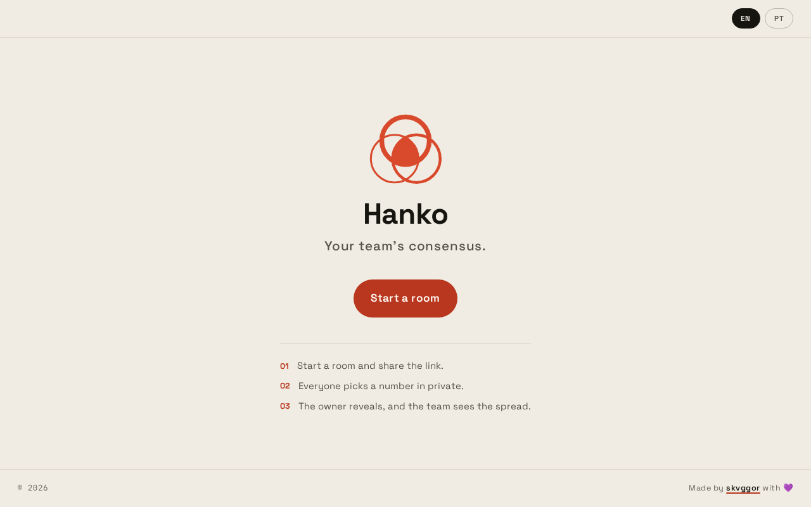

Open Hanko and press **Start a room**. The room is created and you land in it as its
owner. The first person in a room always owns it.

If you arrived through a link someone shared, skip to the next step: the room already
exists and you are joining it.

## 2. Enter your name

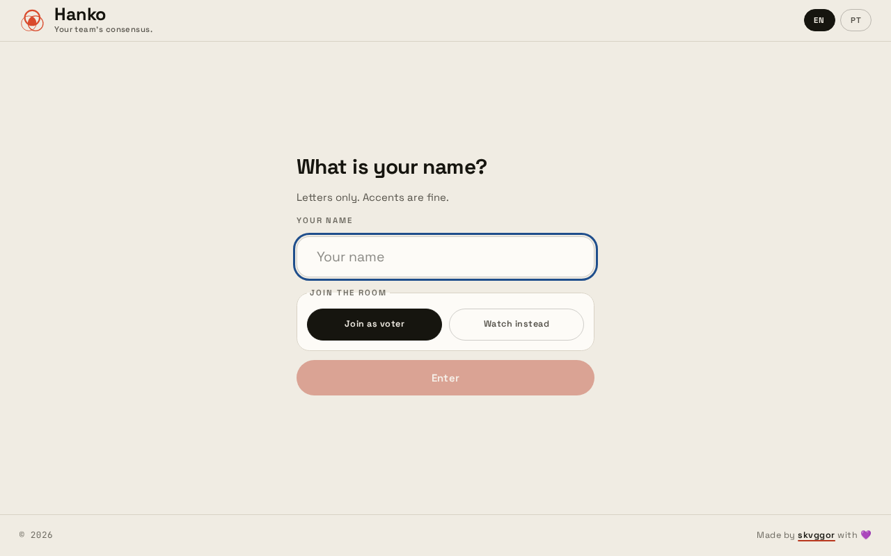

Type the name the room will see. Letters only, accents are fine, up to 24 characters.
Then choose how you take part:

- **Join as voter**: you pick cards and your vote counts.
- **Watch instead**: you see everything but never vote, and you are left out of the
  average. Useful for a facilitator or an observer.

Press **Enter**. Hanko remembers the name you used in a room, so you do not have to
type it again.

## 3. Share the link

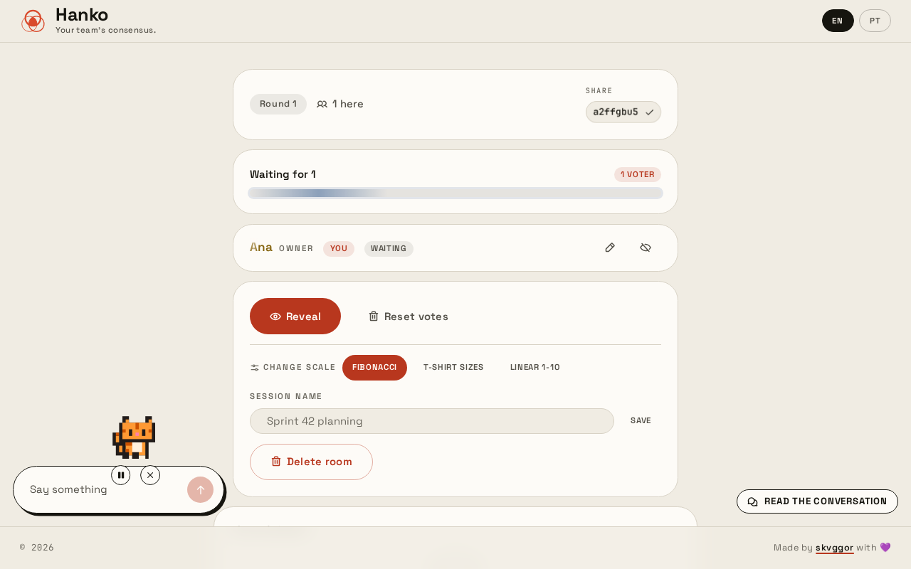

The chip at the top of the room holds the invitation. It shows the room id, and
pressing it copies the whole link to send to the team. Anyone who opens it joins the
same room, so share it only with the people who should be there.

The room header shows the round number and how many people are present.

## 4. Vote in private

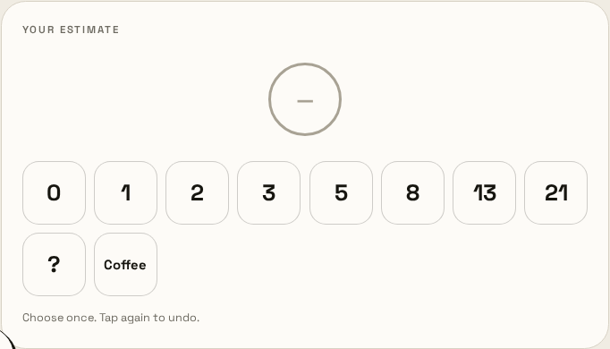
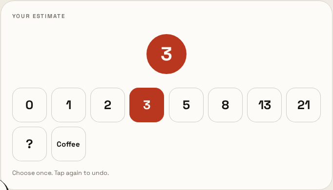

Pick a card from the grid. Your choice lands on the seal above the grid and the card
stays pressed. **Tap the same card again to undo** the vote.

Votes are private until the owner reveals. The server keeps them hidden: nobody, not
even the owner, can see the cards while the room is still voting. The only thing
visible is *who* has already voted.

The scale is one of three, chosen by the owner (see
[Running a session](#7-running-a-session)):

| Scale | Cards |
| --- | --- |
| Fibonacci | `0 1 2 3 5 8 13 21 ? Coffee` |
| T-shirt sizes | `XS S M L XL XXL` |
| Linear 1-10 | `1 2 3 4 5 6 7 8 9 10` |

On the Fibonacci scale, two cards mean something other than a number:

- **`?`**: "we need to discuss this". It counts as an answer but has no points, so it
  stays out of the average and the range, and shows up as "need discussion".
- **Coffee**: an answer worth zero points. It counts in the average like any other
  card and shows up as "on coffee".

## 5. Reveal

When everyone has voted, the owner presses **Reveal**. Each vote appears as a seal
carrying the person's name and their card, and the results appear underneath.

Revealing is owner only. If you do not see the button, you are not the owner. The
owner can hand the room over to you (see [Managing people](#8-managing-people)).

## 6. Reading the results

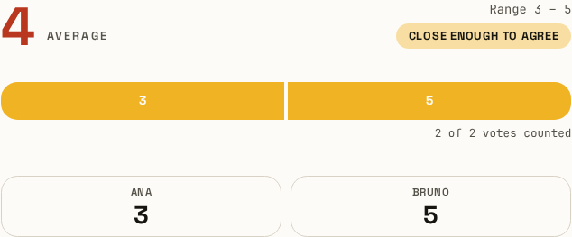

- **Average**: the numeric votes averaged, rounded to one decimal. `?` votes are left
  out entirely; coffee counts as zero. On a scale without numbers (T-shirt sizes)
  there is nothing to average and the average reads `–`.
- **Range**: the lowest and highest numeric votes.
- **Consensus badge**: how far apart the votes landed, measured against the average:
  - **The room agrees**: the votes are close together.
  - **Close enough to agree**: the votes are spread, but not by much.
  - **The room is split**: the votes are far apart. Talk it through and vote again.
- **Spread bar**: one segment per card chosen, sized by how many picked it.
- The small print counts the `?` votes, the coffee votes and how many votes the
  average used.

**The numbers do not move after the reveal.** If somebody's connection drops and their
seat is freed five minutes later, the figures you are reading stay exactly as they
were shown, name included. The next round starts from who is actually there.

## 7. Running a session

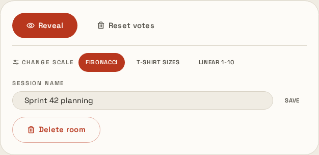

The owner's panel holds the controls for the room:

- **Reveal** turns into **Next round** once the votes are out. **Next round** starts
  a new vote with the same people and the same scale.
- **Reset votes** clears the cards but keeps the round number. Use it when someone
  voted by accident and the room wants the same round again.
- **Change scale** switches between Fibonacci, T-shirt sizes and Linear 1-10. Votes
  that do not exist on the new scale are dropped, so change the scale before voting,
  not after.
- **Session name** names the meeting (for example "Sprint 42 planning"). The name
  shows in the header and in the leave confirmation.
- **Delete room** removes the room and every vote in it for everyone. It cannot be
  brought back.

## 8. Managing people

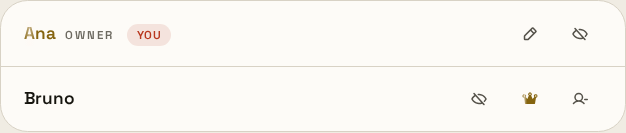

The list leads with the owner, whose name is written in gold, and your own row comes
right below them. A "You" marker points at the row that is yours.

Every action is an icon: rest the pointer on it, or reach it with the keyboard, and
its name appears.

- **Pencil**: change your own name.
- **Crown (Make owner)**: hand the room over. Only one owner at a time, and they get
  the reveal and management controls.
- **Eye (Make watcher / Make voter)**: move someone between voting and watching. The
  owner can turn their own row into a watcher as well, which is how someone runs the
  room without voting in it.
- **Remove**: kick someone out. That browser is refused the room from then on, even
  after a reload. It is not the link that is closed, only that person's place in it:
  the room id is the only secret this app has, so anyone opening the link from another
  browser still gets in.

## 9. Chat

The chat dock sits in the corner of the room. It opens itself on a wide screen; press
the launcher to open it, the minus to minimise it.

Messages are limited to 280 characters, and the conversation keeps the last 100. A
badge counts what you missed while the chat was minimised. Anything that looks like a
web address turns into a link you can follow, which opens in a new tab.

**This room is not private and the chat is not encrypted.** Anyone holding the room
link can read everything said here. You are told this the first time you open the
chat, once per browser.

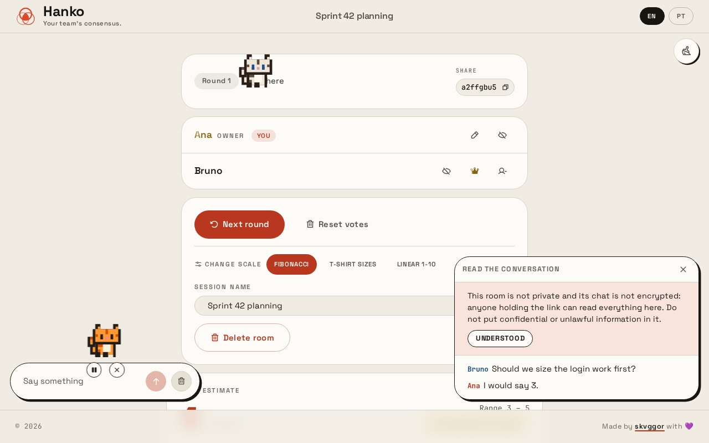

On a desktop there is a button in the bottom corner that reads the whole conversation
back, including anything said before you arrived. What people said outlives their
presence in the room: leaving, being removed, or having your seat freed five minutes
after a dropped connection all leave their words in place.

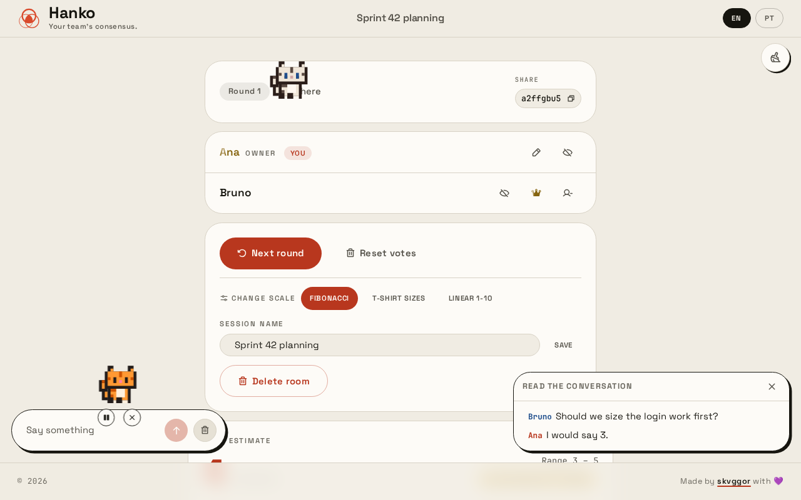

The owner can clear the conversation. It asks first, because it takes every message
from under the room at once.

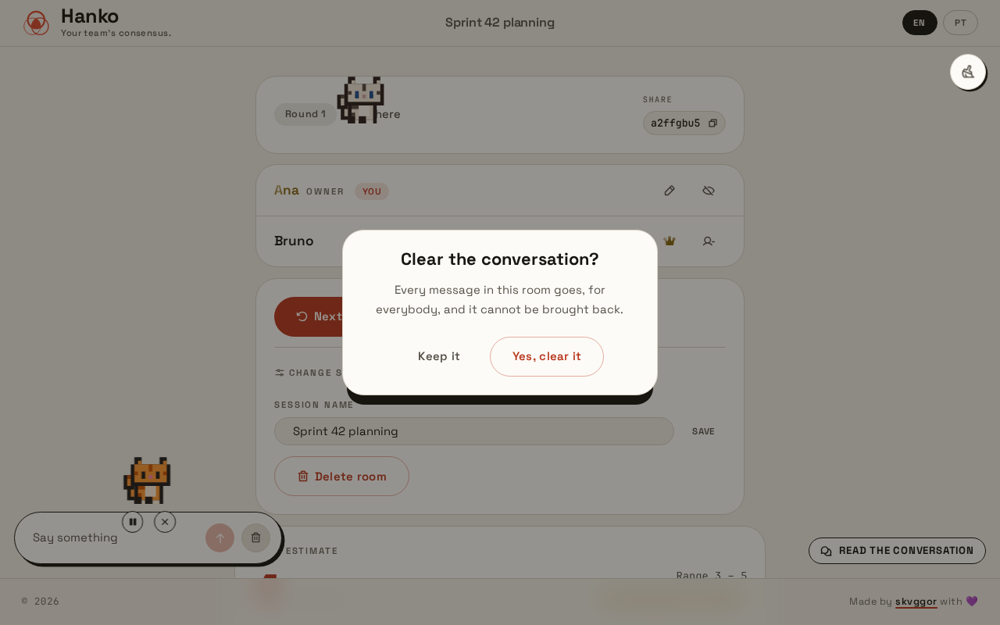

## 10. Your cat

Every person in the room has a cat. It walks about on its own, and it sleeps once
nobody has moved anything for a minute. Its breed and its pace belong to you, so
your cat is the same one every time you come back.

Click your own cat to take the keyboard: the arrow keys walk it, space makes it hop,
and escape lets go of it. While you are holding it, those keys are yours and nothing
else on the page takes them, so the room still scrolls as usual. Walking into another
cat earns you a short-lived sulk, and the cat carries on afterwards.

A ring and your cat's name appear while you are actually driving it, focus and all.
Letting the focus go puts them away even if you are still holding the cat, because
the arrow keys have stopped answering to it.

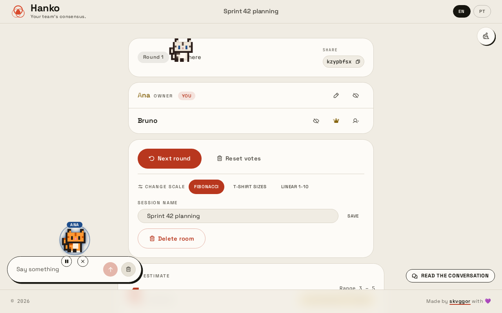

Two small buttons sit under your cat. One pauses it where it stands, for everybody,
and one sends it away. **Sending a cat away is for good and for everyone:** it leaves
the screen for the whole room and does not come back, including for you. The button
is an X and does not ask for confirmation, so use it only if you mean to remove the
cat permanently. Your seat, your name and your vote are untouched by it.

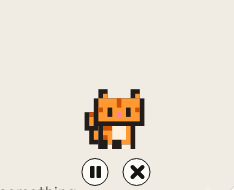

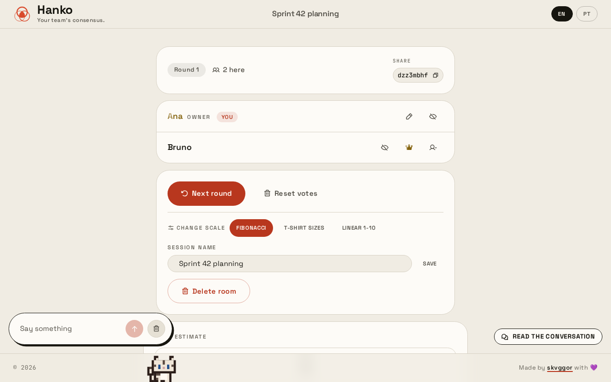

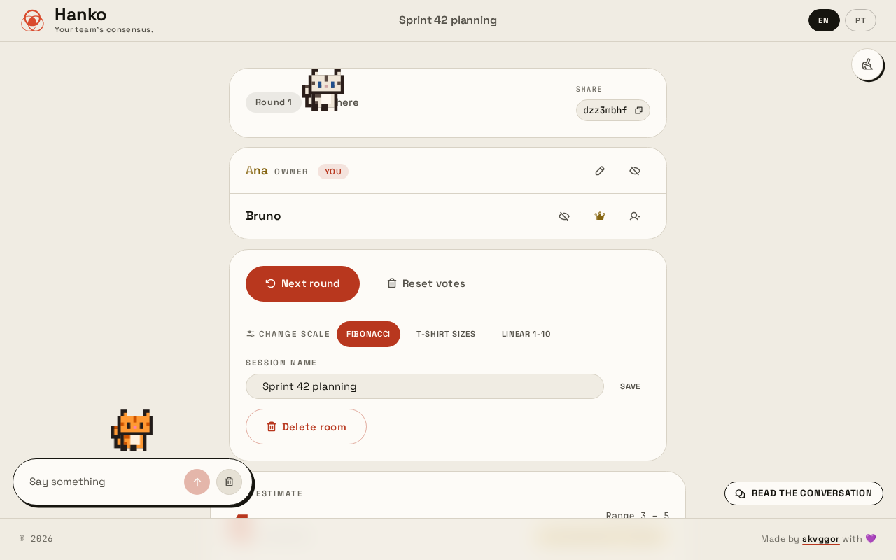

A broom in the top corner walks every cat out to the edges of the screen, so the
grid is readable again in a crowded room. Anyone can use it, not only the owner,
because a cat over the grid is in the way of everyone reading it. It is a nudge and
not a rule: a cat nobody is driving wanders back on its own, and you can press it
again.

On a phone or tablet the cats are replaced by the chat panel instead: a moving
target is not something to tap at, so the cats step aside rather than sit in the way.
The broom is still there, because the cats you cannot see are still standing on
everybody else's screen.

**The conversation on a phone is the chat panel and nothing more.** The read-back
button and the privacy notice live with the cats, so on a touch device you get the
conversation as it arrives and not the whole history.

## 11. Leaving and deleting

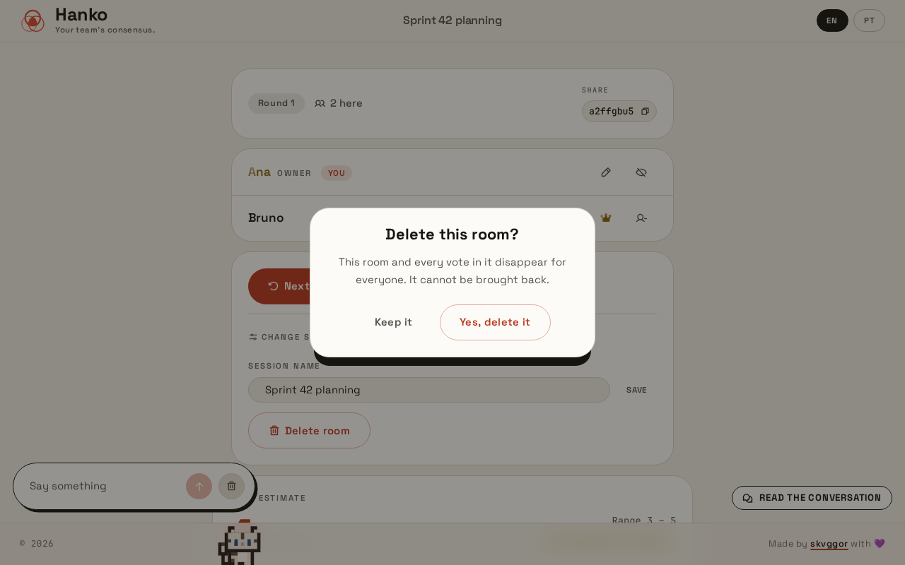

Pressing the Hanko mark in the header asks before leaving. **Your seat is kept for
five minutes** after you go, so a reload or a lost connection does not cost you your
spot, and your cat waits where you left it. After that your seat is freed and your
name leaves the list, along with your vote and your cat. What you said in the chat
stays.

If the person who goes was the owner, the room hands itself to somebody still in it
rather than sitting there with a name nobody can answer to.

Deleting a room asks first. The room, the votes and the chat disappear for everyone
and cannot be brought back. The same thing happens on its own about five minutes
after the last person leaves.

## Good to know

- **Votes are private until revealed.** They live on the server and are only ever
  returned to the client that cast them. There is nothing to inspect in the page.
- **Limits.** 50 people in a room, names up to 24 letters, session names up to 60
  characters, chat messages up to 280.
- **Coming back.** The name you used is kept per browser, so returning to a room
  fills the field in for you and says so. One press of Enter is enough, and if the room
  has since expired you are told that instead.

  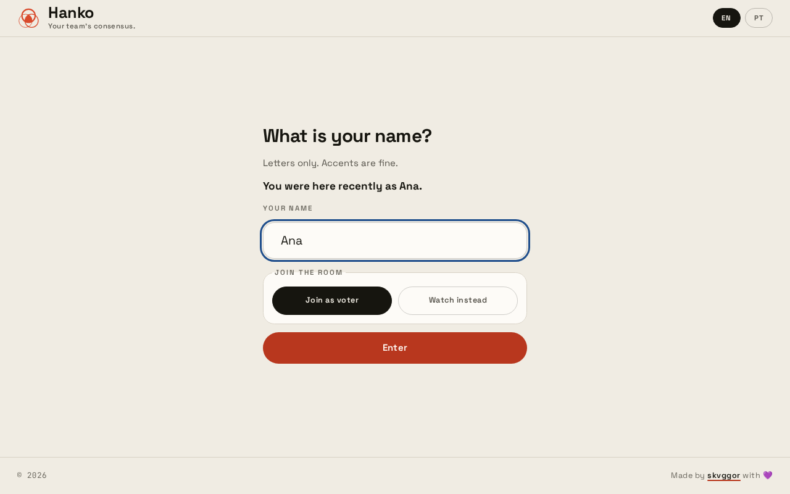
- **Language.** The `EN` / `PT` switch in the header covers the interface.
- **Accessibility.** Every action is keyboard reachable, dialogs move focus on their
  own, and animations step aside when your system asks for reduced motion.
- **A dropped connection is chased, not the end of the room.** The room holds your seat
  for five minutes, so the page keeps trying to get back on its own, waiting longer
  between each attempt. After a minute of no luck it says so and offers a button to try
  again. Nothing you voted is lost while that happens.
